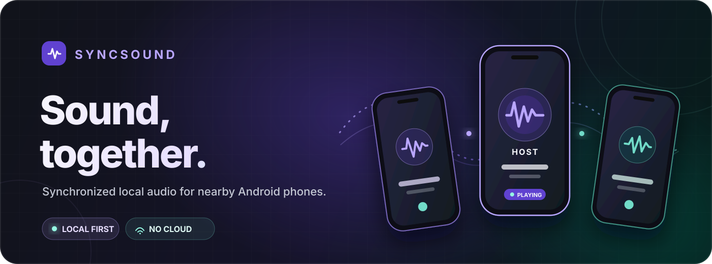
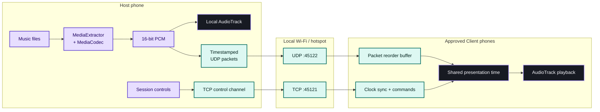
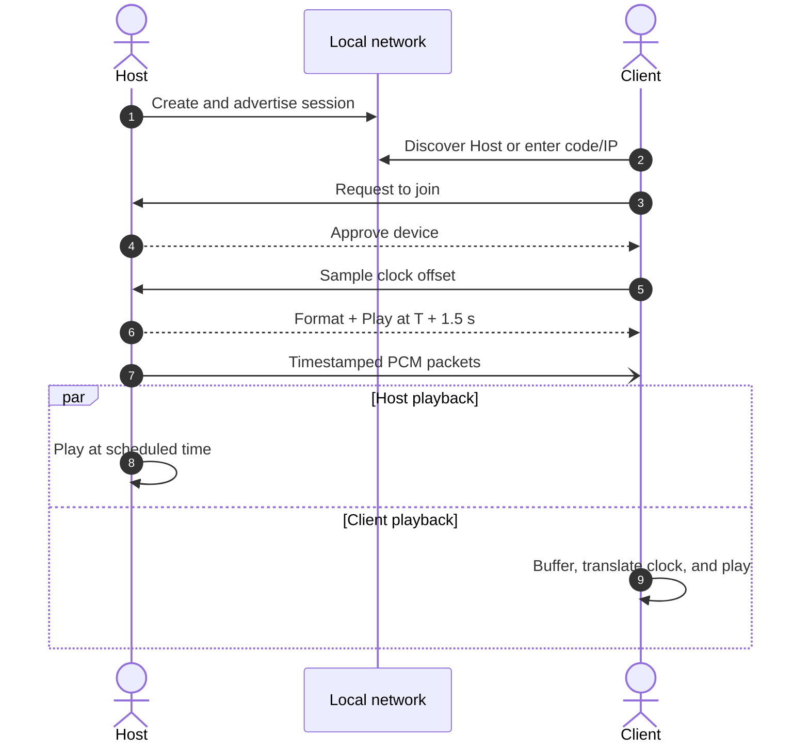

<div align="center">
  

  <h1>SyncSound</h1>

  
  
  
  

  <p><strong>Turn nearby Android phones into one shared listening experience.</strong></p>
  <p>
    <a href="#quick-start">Quick start</a>
    ·
    <a href="SETUP.md">Setup guide</a>
    ·
    <a href="docs/ARCHITECTURE.md">Architecture</a>
    ·
    <a href="docs/RC1_TEST_PLAN.md">Test plan</a>
  </p>
</div>

> [!IMPORTANT]
> SyncSound is currently a **Version 1 release candidate** for local testing. Traffic stays on the local network, but it is not encrypted. Use it only on networks and with devices you trust.

## Sound, together

SyncSound streams audio from one **Host** phone to approved **Client** phones on the same Wi-Fi network or mobile hotspot. The Host decodes audio once, distributes timestamped PCM packets, and schedules playback against a shared monotonic clock so every device starts on the same timeline.

No cloud account or internet connection is required for a session.

<table>
  <tr>
    <td width="33.33%" align="center" valign="top">
      <br />
      <strong>① Create</strong><br />
      <sub>Start a private listening session from one phone.</sub>
      <br /><br />
    </td>
    <td width="33.33%" align="center" valign="top">
      <br />
      <strong>② Connect</strong><br />
      <sub>Approve nearby phones over Wi-Fi or a hotspot.</sub>
      <br /><br />
    </td>
    <td width="33.33%" align="center" valign="top">
      <br />
      <strong>③ Listen</strong><br />
      <sub>Press play once and hear the same moment together.</sub>
      <br /><br />
    </td>
  </tr>
</table>

| | Capability | What it gives you |
|:--:|---|---|
| ◉ | **Nearby discovery** | Find Hosts automatically with Android DNS-SD, or connect by session code/IP address. |
| ✓ | **Host approval** | Review, approve, reject, and remove every phone that requests access. |
| ≋ | **Synchronized playback** | Use clock-offset sampling, future start times, and timestamped audio to keep phones aligned. |
| ▶ | **Shared controls** | Play a queue, pause, resume, stop, skip, and change volume from the Host. |
| ⏱ | **Sync test** | Play a short confirmation tone and inspect the result for each connected device. |
| ◌ | **Session resilience** | Continue in a foreground service and reconnect approved devices after brief network loss. |

## How it works



The control plane and media plane are intentionally separate: reliable TCP carries identity, approval, clock probes, formats, and playback commands; bounded UDP datagrams carry low-latency PCM audio. If a media packet is missing, the Client inserts timestamp-derived silence instead of pulling later audio forward and breaking the group timeline.

## Quick start

You will need:

- Android Studio with Android SDK Platform 36
- JDK 17 (Android Studio's bundled JDK is recommended)
- Two physical Android phones running Android 8.0 / API 26 or newer
- A shared Wi-Fi network or mobile hotspot

Build and test the debug app:

```bash
./gradlew test assembleDebug
```

The APK will be available at:

```text
app/build/outputs/apk/debug/app-debug.apk
```

Install it on both phones with Android Studio, or use ADB:

```bash
adb install -r app/build/outputs/apk/debug/app-debug.apk
```

See the [complete setup guide](SETUP.md) for SDK installation, permissions, release builds, and troubleshooting.

## Start a listening session



1. Put both phones on the same Wi-Fi network and disable Bluetooth audio.
2. On phone A, tap **Create a session**.
3. On phone B, tap **Join a session** and select the discovered Host. The six-digit code and manual IP address are available as fallback connection methods.
4. Approve phone B on the Host, then run **Test Sync**.
5. Choose one or more supported audio files on the Host and press **Play**.

## Technical profile

| Area | Implementation |
|---|---|
| Platform | Native Android, single activity, minimum API 26 |
| UI | Kotlin, Jetpack Compose, Material 3, MVVM |
| Audio input | MP3, PCM WAV, AAC/M4A, and FLAC through Android platform codecs |
| Audio output | 16-bit PCM through `AudioTrack` |
| Discovery | Android NSD / DNS-SD service `_syncsound._tcp` |
| Control transport | Versioned binary protocol over TCP `45121` |
| Media transport | PCM over UDP `45122`, maximum 1,200-byte datagrams |
| Synchronization | Smoothed clock offsets and a 1.5-second scheduled start lead |
| Background operation | Visible Android foreground service |
| Dependency injection | Small manual composition root |

## Project structure

```text
SyncSound/
├── app/src/main/java/com/syncsound/app/
│   ├── audio/       # Decode, capture, packetize, buffer, and play PCM
│   ├── data/        # Session state and orchestration
│   ├── di/          # Manual application composition root
│   ├── logging/     # Structured application and crash logging
│   ├── model/       # Immutable UI and domain models
│   ├── network/     # Discovery, TCP control, UDP protocol, monitoring
│   ├── service/     # Active-session foreground service
│   ├── ui/          # Compose screens, components, and ViewModels
│   └── util/        # Network helpers
├── app/src/test/    # Packet, buffer, tone, and control-server tests
├── docs/            # Architecture, test plan, and capture notes
├── SETUP.md         # Detailed build and two-phone test guide
└── README.md
```

## Experimental system audio

On Android 10 and newer, a Host can try Android's official playback-capture API to share audio from another application. This requires `RECORD_AUDIO` permission and explicit approval of Android's screen-capture prompt for each session.

Capture availability is controlled by Android and the source app. DRM services and apps that opt out may produce silence; SyncSound does not bypass those restrictions. Read [System Audio Capture](docs/SYSTEM_AUDIO_CAPTURE.md) before testing this feature.

## Current limitations

- Best suited to small groups: stereo PCM uses roughly 1.4–1.5 Mbit/s **per Client** before Wi-Fi overhead.
- Bluetooth introduces device-specific latency; use phone speakers or wired outputs for synchronization tests.
- Android hardware and speaker DSP latency are not acoustically calibrated, so different phone models can still have an audible offset.
- Routers or hotspots with wireless client isolation will prevent devices from connecting.
- Local traffic is cleartext in Version 1. Approval limits who receives playback, but it is not cryptographic authentication.
- Codec availability can vary by phone manufacturer even when a file type is supported by the app.

## Development

Run the main local checks:

```bash
./gradlew test
./gradlew lint
./gradlew assembleDebug
./gradlew assembleRelease
```

Important events use the `SyncSound` Logcat tag with structured `area=... event=...` fields:

```bash
adb logcat -s SyncSound
```

For physical-device acceptance criteria, follow the [RC1 test plan](docs/RC1_TEST_PLAN.md).

## Documentation

- [Setup and two-device testing](SETUP.md)
- [Version 1 architecture](docs/ARCHITECTURE.md)
- [RC1 acceptance test plan](docs/RC1_TEST_PLAN.md)
- [Experimental system-audio capture](docs/SYSTEM_AUDIO_CAPTURE.md)

<div align="center">
  <sub>Built for nearby listening — no cloud required.</sub>
</div>
